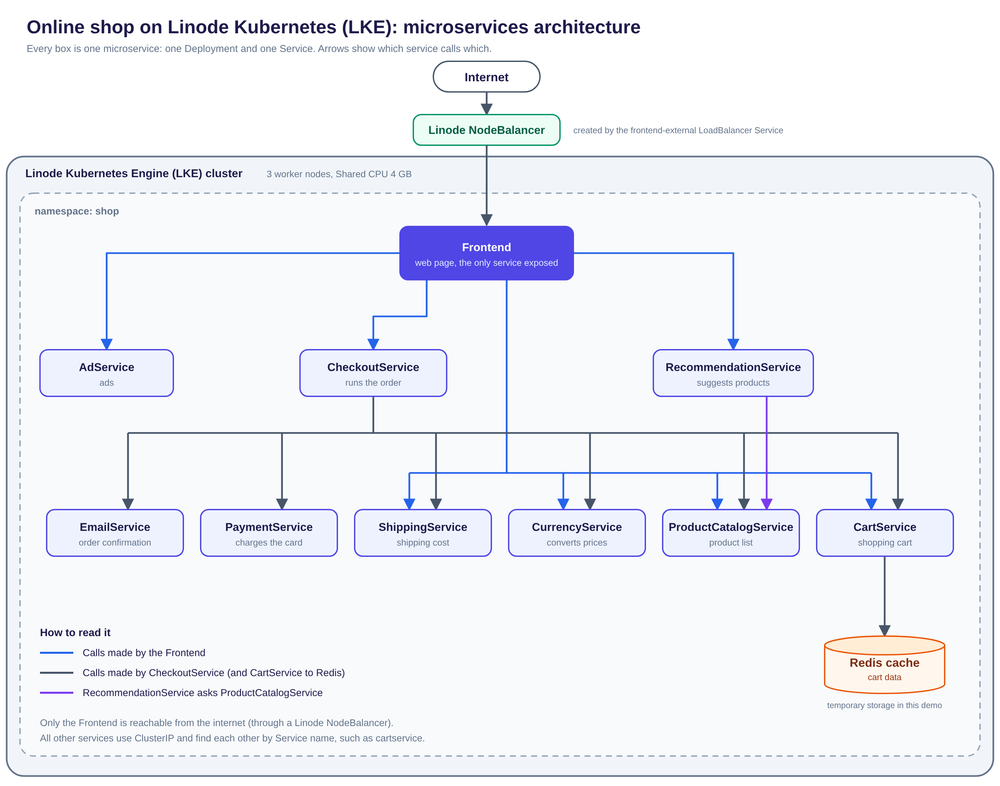
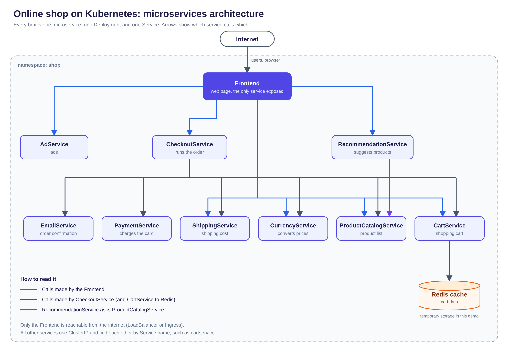

# Microservices Online Shop on Kubernetes (Linode LKE)

A hands-on DevOps project: deploying an 11-service online shop to a Kubernetes cluster on **Linode Kubernetes Engine (LKE)**, exposing it to the internet, and fixing the problems that came up along the way.

The application is **Online Boutique** by Google Cloud (Apache 2.0): https://github.com/GoogleCloudPlatform/microservices-demo. I did not write the application code. The work in this repo is the deployment, the debugging and the documentation. Practice project from the TechWorld with Nana DevOps Bootcamp.

## Architecture



The same application, without the infrastructure:



| Service | Job |
|---|---|
| frontend | Web page, the only service exposed to the internet |
| productcatalogservice | Product list |
| cartservice | Shopping cart (stores in `redis-cart`) |
| checkoutservice | Runs the order: calls cart, product catalog, currency, shipping, payment and email |
| paymentservice, shippingservice, emailservice | Payment, shipping cost, order email |
| currencyservice | Converts prices |
| recommendationservice | Suggests products (calls the product catalog) |
| adservice | Ads |
| redis-cart | Cart storage (temporary storage in this demo) |
| loadgenerator | Sends fake visitors so there is traffic to watch |

- Every service is one **Deployment** and one **Service** (type ClusterIP). Only `frontend-external` is type **LoadBalancer**, which makes Linode create a NodeBalancer.
- Services find each other by Service name (for example `cartservice:7070`), set as environment variables in each Deployment.

## Environment

- Linode Kubernetes Engine, 3 worker nodes (Shared CPU, 4 GB)
- `kubectl` on macOS, namespace `shop`
- Manifest: `config.yaml`, copied from `release/kubernetes-manifests.yaml` and changed in two places (see below)

## Deploy

```bash
# connect to the cluster (the kubeconfig stays outside the repo)
export KUBECONFIG=$HOME/.kube/shop-kubeconfig.yaml
kubectl get nodes                       # 3 nodes Ready

kubectl create namespace shop
kubectl apply -f config.yaml -n shop
kubectl get pods -n shop                # wait until every pod is 1/1 Running
kubectl get svc frontend-external -n shop    # EXTERNAL-IP = the NodeBalancer address
```

Open `http://<EXTERNAL-IP>` in a browser, add an item to the cart and check out.

## Problems I solved

### 1. `adservice`: ImagePullBackOff

- **Symptom:** the pod stayed in `ImagePullBackOff`. `kubectl describe pod` showed `adservice:v0.2.3 ... not found`.
- **Cause:** that tag does not exist in the registry (the other services' `v0.2.3` tags do).
- **How I found a valid tag:** listed the tags through the registry API: `curl -s https://gcr.io/v2/google-samples/microservices-demo/adservice/tags/list`.
- **Fix:** changed only the adservice image to `adservice:v0.3.4`, the closest available version, then `kubectl apply -f config.yaml -n shop`.

### 2. `recommendationservice`: CrashLoopBackOff

- **Symptom:** the pod kept restarting. The probe events said `Liveness probe failed: command timed out`.
- **Cause:** the logs showed the app trying to start the Google Cloud Profiler and waiting on the Google Cloud metadata server (`Compute Engine Metadata server unavailable`). That server does not exist outside Google Cloud, so the app never opened its gRPC port and the liveness probe killed it.
- **Fix:** turned the Google-only features off in the Deployment:

```yaml
        - name: DISABLE_TRACING
          value: "1"
        - name: DISABLE_PROFILER
          value: "1"
        - name: DISABLE_DEBUGGER
          value: "1"
```

### Smaller things I hit

| Problem | Cause and fix |
|---|---|
| `kubectl` returned an HTML "Authentication required" page | `KUBECONFIG` pointed at a file that did not exist, so `kubectl` fell back to `localhost:8080` (a local Jenkins). Use the full path and check the file with `ls -l` |
| `kubernetes-manifests/` could not be applied directly | Those files use image names like `adservice` for a build tool (skaffold). The `release/` file has the real image addresses |
| `Permission denied` on a folder | A folder needs the `x` permission (`chmod 755`), not just `rw` |
| `emailservice` and `loadgenerator` restarted at first | They started before the services they depend on. They recovered on their own |

## Useful commands

```bash
kubectl get pods -n shop
kubectl describe pod -l app=adservice -n shop | tail -20
kubectl logs -l app=recommendationservice -n shop --tail=30
kubectl get endpoints cartservice -n shop
kubectl scale deploy/frontend --replicas=3 -n shop
kubectl rollout undo deploy/frontend -n shop
```

## Clean up (so nothing keeps billing)

```bash
kubectl delete namespace shop     # also removes the NodeBalancer
```

Then, in the Linode Cloud Manager: check that **NodeBalancers** is empty, delete the cluster, check that **Volumes** and **Linodes** are empty, and look at **Billing**. Delete the local kubeconfig (`rm ~/.kube/shop-kubeconfig.yaml`).

## What I learned

- How a microservices application maps to Kubernetes: one Deployment and one Service per service, with only the entry point exposed.
- How to read `kubectl describe` Events and `kubectl logs` to find the cause of `ImagePullBackOff` and `CrashLoopBackOff`.
- That demo applications built for one cloud may need settings changed to run on another.
- The order for cleaning up cloud resources so nothing keeps billing.

## Next steps

- Add monitoring with Prometheus and Grafana.
- Put the frontend behind an Ingress with TLS.
- Add RBAC so a limited user can only view the `shop` namespace.
- Write a CI/CD pipeline that builds and deploys one service.
